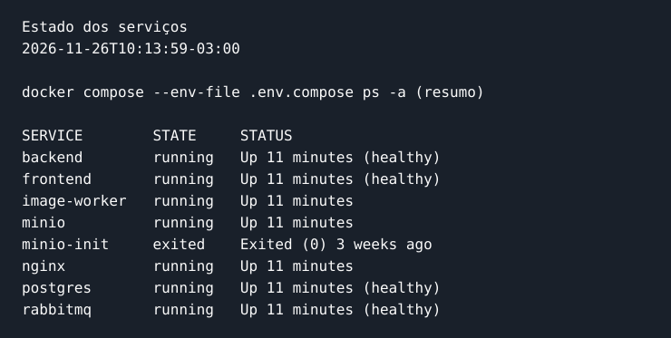
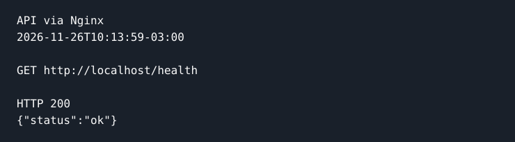
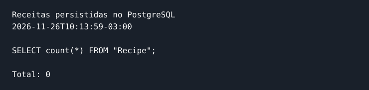
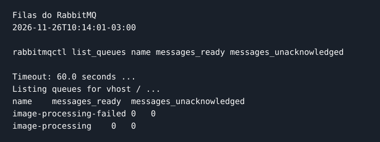
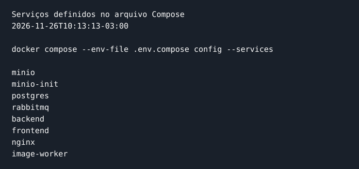

# Smash or Pass

v#### Video Demo: https://youtu.be/u6gNtyVILso


## 📌 Descrição

O **Smash or Pass** é uma aplicação web inspirada no modelo de interação do Tinder, aplicada ao domínio culinário.

A plataforma permite que usuários descubram novas receitas por meio de interações simples de interesse (**Smash**) ou desinteresse (**Pass**), além de possibilitar o cadastro, gerenciamento e compartilhamento de receitas próprias.

O projeto foi desenvolvido como trabalho final da disciplina de Desenvolvimento de Software para Web, aplicando conceitos de:

- Arquitetura Cliente-Servidor
- APIs REST
- Autenticação e Autorização
- Persistência de Dados
- Documentação de Software
- Desenvolvimento Full Stack

---

## 🎯 Objetivo

Desenvolver uma aplicação web completa composta por frontend, backend e banco de dados, demonstrando boas práticas de desenvolvimento e documentação de software.

---

## ⚙️ Principais Funcionalidades

### 🔐 Autenticação

- Cadastro de usuários
- Login com JWT
- Controle de acesso por papéis (RBAC)

### 🍽️ Receitas

- Cadastro de receitas
- Edição de receitas próprias
- Exclusão de receitas próprias
- Upload de imagens
- Moderação de conteúdo

### 🔥 Smash or Pass

- Curtir receitas (Smash)
- Rejeitar receitas (Pass)
- Desfazer última interação
- Priorização de receitas ainda não avaliadas

### 💬 Comentários

- Criação de comentários
- Edição de comentários próprios
- Exclusão de comentários próprios

### 🏷️ Catálogo

- Categorias
- Ingredientes
- Preferências alimentares
- Alergênicos

### 🛠️ Administração

- Aprovação de receitas
- Aprovação de ingredientes
- Aprovação de categorias
- Dashboard administrativo

---

## 📚 Documentação

Toda a documentação do projeto encontra-se na pasta `docs/`.

### Arquitetura

| Documento                             | Descrição                      |
|---------------------------------------|--------------------------------|
| `docs/architecture/erd.md`            | Modelo entidade-relacionamento |
| `docs/architecture/business-rules.md` | Regras de negócio              |
| `docs/architecture/enums.md`          | Enums do sistema               |
| `docs/architecture/conventions.md`    | Convenções arquiteturais       |

### Banco de Dados

| Documento                        | Descrição                              |
|----------------------------------|----------------------------------------|
| `docs/database/prisma-schema.md` | Estrutura do banco e mapeamento Prisma |
| `docs/database/indexes.md`       | Índices e otimizações                  |

### API

| Documento                    | Descrição                  |
|------------------------------|----------------------------|
| `docs/api/authentication.md` | Autenticação e autorização |
| `docs/api/users.md`          | Endpoints de usuários      |
| `docs/api/recipes.md`        | Endpoints de receitas      |
| `docs/api/interactions.md`   | Endpoints de Smash/Pass    |
| `docs/api/comments.md`       | Endpoints de comentários   |
| `docs/api/moderation.md`     | Endpoints administrativos  |
| `docs/api/dashboard.md`      | Dashboard e métricas       |

---

## 🧱 Arquitetura

O sistema segue o modelo **Cliente-Servidor**, dividido em duas aplicações independentes.

**Backend:**

Tecnologias principais:

- Node.js
- TypeScript
- Express
- Prisma ORM
- PostgreSQL
- JWT
- Bcrypt
- Swagger/OpenAPI

Arquitetura em camadas:

```text
Routes
  ↓
Controllers
  ↓
Services
  ↓
Repositories
  ↓
Database
```

**Frontend:**

Tecnologias:

- React
- TypeScript
- Axios
- React Router

Arquitetura baseada em componentes reutilizáveis.

---

## 🛠️ Tecnologias Utilizadas

**Backend:**

- Node.js
- TypeScript
- Express
- Prisma ORM
- PostgreSQL
- JWT
- Bcrypt
- Swagger/OpenAPI

**Backend:**

- React
- TypeScript
- Axios

### Ferramentas

- Git
- GitHub
- Trello
- Excalidraw

---

## 🚀 Como Executar

### Pré-requisitos

- Node.js
- PostgreSQL

---

**Backend:**

```bash
cd backend

npm install

npx prisma migrate dev

npx prisma db seed

npm run dev
```

Backend disponível em:

```text
http://localhost:3000
```

Swagger disponível em:

```text
http://localhost:3000/docs
```

---

**Frontend:**

```bash
cd frontend

npm install

npm run dev
```

Frontend disponível em:

```text
http://localhost:5173
```

---

## 📁 Estrutura do Projeto

```text
smash-or-pass/
│
├── backend/
│   ├── prisma/
│   ├── src/
│   │   ├── routes/
│   │   ├── controllers/
│   │   ├── services/
│   │   ├── repositories/
│   │   ├── middlewares/
│   │   ├── validations/
│   │   ├── utils/
│   │   └── config/
│
├── frontend/
│   ├── src/
│   │   ├── components/
│   │   ├── pages/
│   │   ├── services/
│   │   ├── hooks/
│   │   ├── contexts/
│   │   └── routes/
│
├── docs/
│   ├── architecture/
│   ├── api/
│   └── database/
│
└── README.md
```

---

## 📊 Status do Projeto

**Em desenvolvimento.**

---

## 👨‍💻 Equipe

- [Arthur Vinicius Carneiro Nunes](https://github.com/ArthurViniNunes)
- [João Igor Almeida Gomes](https://github.com/Igoxrx)
- [Marcos Antonio Alencar da Rocha Junior](https://github.com/mirkojr)
- [Samyra Vitória Lima de Almeida](https://github.com/samyraalmeida)

---

## 🤝 Contribuição

Antes de realizar alterações no projeto, consulte:

- `CONTRIBUTING.md`

---

## 📄 Licença

Este projeto está licenciado sob a [licença MIT](LICENSE).

## Trabalho 2 — Docker Compose

O Docker Compose executa Nginx, frontend Next.js, API Express, worker de
imagens, PostgreSQL 16, MinIO e RabbitMQ. A auditoria continua no Amazon
DynamoDB. O frontend tem um Dockerfile próprio, e a API e o worker usam a
mesma imagem com comandos de entrada diferentes. O serviço `minio-init`
prepara o bucket antes de a API iniciar.

### Executar localmente

1. Instale Git, Docker Engine ou Docker Desktop com Compose v2 e AWS CLI.
   Inicie o Docker e verifique o acesso ao daemon com `docker info`. Deixe a
   porta 80 do host disponível para o Nginx.
2. Clone o repositório e copie o exemplo de configuração na raiz.

   ```sh
   git clone https://github.com/ArthurViniNunes/smash-or-pass.git
   cd smash-or-pass
   cp .env.compose.example .env.compose
   ```

   No PowerShell, use `Copy-Item .env.compose.example .env.compose`.

3. Edite `.env.compose`. Defina `JWT_SECRET`, as senhas dos serviços e, se
   for usar o seed, `SEED_PASSWORD`. A senha em `DATABASE_URL` e `DIRECT_URL`
   deve corresponder a `POSTGRES_PASSWORD`. A senha em `RABBITMQ_URL` deve
   corresponder a `RABBITMQ_PASSWORD`. Se as senhas nas URLs contiverem
   caracteres reservados, codifique-os na URL. Mantenha `CORS_ORIGINS`
   coerente com a origem usada no navegador.
4. Configure a tabela `smash-or-pass-audit` na região de `AWS_REGION`.
   A chave de partição é `id`, do tipo String. Se a tabela ainda não existir,
   crie-a com a AWS CLI autenticada. O exemplo usa `us-east-1`.

   ```sh
   aws dynamodb create-table --region us-east-1 --table-name smash-or-pass-audit --attribute-definitions AttributeName=id,AttributeType=S --key-schema AttributeName=id,KeyType=HASH --billing-mode PAY_PER_REQUEST
   aws dynamodb wait table-exists --region us-east-1 --table-name smash-or-pass-audit
   ```

   Para execução local, configure `AWS_ACCESS_KEY_ID`, `AWS_SECRET_ACCESS_KEY`
   e, para credenciais temporárias, `AWS_SESSION_TOKEN` em `.env.compose`,
   que fica fora do Git. A aplicação usa `dynamodb:PutItem`. A identidade
   que consulta os eventos precisa de permissão de leitura, como
   `dynamodb:Scan` para o comando abaixo.

5. Valide a configuração, suba os serviços e confira o status.

   ```sh
   docker compose --env-file .env.compose config -q
   docker compose --env-file .env.compose up --build -d
   docker compose --env-file .env.compose ps -a
   curl -fsS http://localhost/health
   ```

   No PowerShell, use `curl.exe -fsS http://localhost/health`. Abra
   [http://localhost](http://localhost). O primeiro build também compila
   a imagem do MinIO. O backend aplica as migrations do Prisma na partida,
   e `minio-init` deve terminar com `Exited (0)` após criar o bucket.

6. Em um banco de teste, carregue categorias, ingredientes e dados de exemplo
   antes de reproduzir o fluxo de cadastro de receita. **O seed apaga os
   dados relacionais existentes.** Execute-o somente em uma base descartável
   ou nova.

   ```sh
   docker compose --env-file .env.compose exec backend npx prisma db seed
   ```

### Evidências de funcionamento

Na execução local de 26/11/2026, sete serviços estavam em execução e o `minio-init` havia terminado com código 0. O Nginx encaminhou a requisição para a API, que respondeu com HTTP 200. A consulta ao PostgreSQL retornou zero receitas e as filas do RabbitMQ estavam vazias no momento da captura.










**Configuração verificada.** A saída abaixo lista os oito serviços
declarados no arquivo Compose. O estado de execução é obtido com `ps -a`.




*Captura da interface já registrada no projeto. As verificações abaixo
comprovam a execução do Trabalho 2 e devem usar a mesma receita de teste.*

1. **Docker Compose e disponibilidade.** Capture a saída de `ps -a` com
   PostgreSQL, MinIO, RabbitMQ, API, frontend, worker e Nginx em execução.
   Inclua `minio-init` com `Exited (0)` e a resposta de `/health`.
2. **PostgreSQL e MinIO.** Em um ambiente de teste, cadastre uma receita
   com título único e envie uma imagem. Em **Minhas receitas**, reabra
   a receita, que pode estar pendente de moderação, e confirme a resposta HTTP `200` para a imagem em `/api/media/` na aba **Rede** do
   navegador. Recrie os contêineres mantendo os volumes e capture a mesma
   receita e imagem após a subida. A receita comprova a persistência no
   PostgreSQL, e a leitura da foto comprova o acesso ao objeto no MinIO.

   ```sh
   docker compose --env-file .env.compose down
   docker compose --env-file .env.compose up -d
   docker compose --env-file .env.compose ps -a
   ```

   Use `down` sem `-v` para preservar os volumes. O processo interrompe
   o serviço temporariamente.

3. **RabbitMQ e worker.** Capture a fila `image-processing` e o log
   `Processed image:` associado ao arquivo do teste. A linha do worker
   confirma o consumo e o processamento, mesmo que a fila já esteja vazia.

   ```sh
   docker compose --env-file .env.compose exec rabbitmq rabbitmqctl list_queues name messages_ready messages_unacknowledged
   docker compose --env-file .env.compose logs --tail 50 image-worker
   ```

4. **DynamoDB.** No console, abra a tabela de auditoria e localize o evento
   `CREATE` pela rota `/recipes` e pelo horário do teste. Capture a ação,
   a rota, o status e o horário. Na CLI, o comando abaixo retorna uma
   amostra de itens, que pode conter eventos de outros testes.

   ```sh
   aws dynamodb scan --region us-east-1 --table-name smash-or-pass-audit --max-items 5
   ```

Para a entrega, salve as capturas da execução em `docs/evidencias/` e
vincule-as aos itens correspondentes nesta seção. Use dados de teste e
mantenha credenciais e tokens fora das capturas.

### Execução em EC2

O mesmo Compose pode rodar em uma única instância EC2 para correção online.
Ajuste `CORS_ORIGINS` para o endereço usado no navegador, permita HTTP na
porta 80 no Security Group e use um perfil IAM com acesso de gravação à
tabela do DynamoDB. Com o perfil IAM, omita as variáveis de credenciais AWS
do `.env.compose`. A API, o banco, a fila e o armazenamento se comunicam
pela rede interna do Compose.

Consulte o [guia de Docker Compose](docs/docker-compose.md) para detalhes
de rede, volumes, dependências e diagnóstico. O PostgreSQL local recebe
o esquema pelas migrations. A restauração de dados do RDS e de objetos
antigos do S3 depende dos backups desses recursos. Consulte a
[arquitetura do Trabalho 1](docs/aws-services-architecture.md) para o
desenho anterior.
